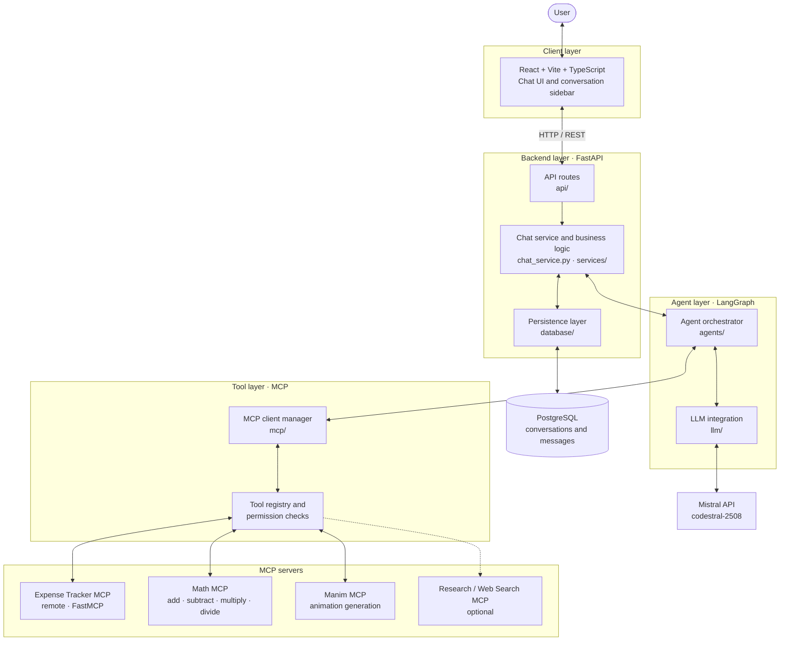
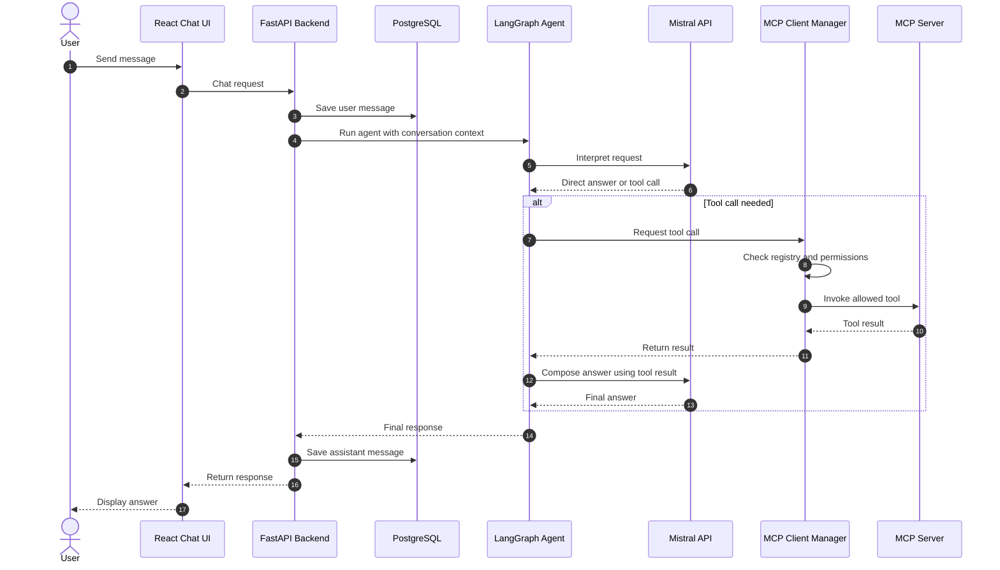
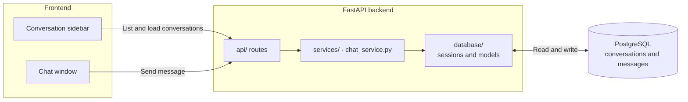
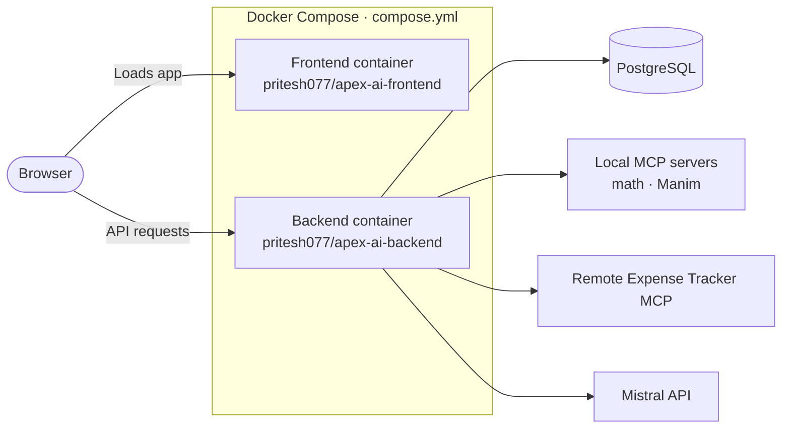

# Apex AI Agent
 
**Apex AI Agent** is a modular, tool-using AI assistant built with **LangGraph**, **MCP (Model Context Protocol)**, **FastAPI**, **React**, and **PostgreSQL**. It offers a single, minimalist chat interface through which the agent can answer questions, call connected tools, and be extended with additional MCP servers.
 
The chat experience is deliberately separated from individual integrations: new capabilities are added by registering MCP servers and controlling their tools through the backend.
 
---
 
## Table of contents
 
- [Key features](#key-features)
- [Architecture](#architecture)
- [Technology stack](#technology-stack)
- [Repository structure](#repository-structure)
- [MCP servers and status](#mcp-servers-and-status)
- [PostgreSQL chat history](#postgresql-chat-history)
- [Getting started](#getting-started)
- [Docker Hub images](#docker-hub-images)
- [Adding more MCP servers](#adding-more-mcp-servers)
---
 
## Key features
 
- **Single chat interface**: a minimalist React UI with a conversation sidebar.
- **Tool-using agent**: LangGraph decides when to answer directly and when to call a tool.
- **Pluggable tools via MCP**: add or remove capabilities by registering MCP servers, with no changes to the chat UI.
- **Permission-controlled tools**: a registry and permission layer restricts which tools the agent may call.
- **Persistent chat history**: conversations and messages are stored in PostgreSQL and reloaded in the sidebar.
- **Containerized**: separate backend and frontend images, orchestrated with Docker Compose.
---
 
## Architecture
 
### System overview
 

 
### Request lifecycle
 

 
---
 
## Technology stack
 
| Layer | Technology | Responsibility |
|---|---|---|
| Frontend | React, Vite, TypeScript | Chat interface and conversation sidebar |
| Backend API | Python, FastAPI | API endpoints and application coordination |
| Agent orchestration | LangGraph | Agent flow, model calls, and tool execution |
| Language model | Mistral API | Interprets requests and generates responses (model setting: `codestral-2508`) |
| Tool protocol | MCP / FastMCP | Connects the agent to independently exposed tools |
| Chat storage | PostgreSQL | Persists conversations and messages |
| Python tooling | `uv`, `pyproject.toml` | Dependency and environment management |
| Containers | Docker, Docker Compose | Packages and runs the frontend and backend |
 
---
 
## Repository structure
 
```text
ApeX AI/
├── backend/
│   ├── src/
│   │   ├── apex_ai/
│   │   │   ├── agents/            # LangGraph agent definitions and orchestration
│   │   │   ├── api/               # FastAPI routes (chat, conversations)
│   │   │   ├── core/              # Core configuration and shared utilities
│   │   │   ├── database/          # PostgreSQL connection, sessions, and models
│   │   │   ├── llm/               # Language model (Mistral) integration
│   │   │   ├── mcp/               # MCP client manager, tool registry, permissions
│   │   │   ├── mcp_servers/       # Locally hosted MCP servers (e.g. math, Manim)
│   │   │   ├── schemas/           # Pydantic request/response schemas
│   │   │   ├── services/          # Business logic
│   │   │   ├── __init__.py
│   │   │   ├── chat_service.py    # Chat orchestration service
│   │   │   └── main.py            # FastAPI application entry point
│   │   ├── migrations/            # Database migrations
│   │   └── tests/                 # Backend tests
│   ├── Dockerfile                 # Backend image
│   └── uv.lock                    # Locked backend dependencies
│
├── frontend/
│   ├── src/                       # React + TypeScript source
│   ├── .env.example               # Template for frontend environment variables
│   ├── Dockerfile                 # Frontend image
│   ├── index.html
│   ├── package.json
│   ├── package-lock.json
│   ├── tsconfig.json
│   ├── tsconfig.app.json
│   ├── tsconfig.node.json
│   └── vite.config.ts             # Vite configuration
│
├── docs/                          # Project documentation
│
├── .gitignore
├── .python-version                # Pinned Python version
├── backend-requirements.txt       # Backend dependency list
├── expense-requirements.txt       # Dependencies for the expense MCP environment
├── compose.yml                    # Docker Compose services
├── package.json
├── package-lock.json
├── pyproject.toml                 # Python project configuration
├── uv.lock
└── README.md
```
 
**Local-only files (never commit):** `.env`, `frontend/.env.local`, `.venv/`, `.venv-expense/`, `frontend/node_modules/`, and `__pycache__/`. Make sure all of them are listed in `.gitignore`.
 
> Folder descriptions above reflect each folder's role as named in the project layout. Adjust a comment if a folder's contents differ in your checkout.
 
---
 
## MCP servers and status
 
A server should be described as **live** only when its process or endpoint is reachable, the backend's MCP client connects without errors, and the agent discovers its tools. The table below documents the intended integrations; it is not a live health check.
 
| MCP integration | Purpose / tools | Status |
|---|---|---|
| **Expense Tracker MCP** | Remote FastMCP service for adding expenses, listing expenses, and summarizing spending by category. It maintains its own expense data. | Remote endpoint configured. Confirm reachability and tool discovery in backend logs. |
| **Math MCP** | Arithmetic: addition, subtraction, multiplication, and division. Division must validate a zero denominator and return a clear error. | Count as live only once the server is running, registered, and its tools are discovered. |
| **Manim MCP** | Exposes `execute_manim_code` to generate mathematical and educational animations. Requires the Manim runtime and its dependencies. | Implemented locally. Running state must be verified. |
| **Research / Web Search MCP** | Optional search/research tools (e.g. `web_search`). | Optional. Not counted as live without a successful connection. |
 
### Verifying a server
 
1. The process is running, or the remote endpoint is reachable.
2. The backend establishes an MCP client connection without errors.
3. The server's tools appear in the tool registry.
4. A safe test call returns the expected result.
Check `docker compose logs -f backend` for connection and tool-discovery messages to confirm how many servers are actually live.
 
---
 
## PostgreSQL chat history
 
PostgreSQL stores each user's conversations and messages so previous chats can be reloaded in the sidebar after a page refresh.
 

 
- The frontend retrieves history **only through the backend API** and never connects to PostgreSQL directly.
- Schema changes are managed through the `backend/src/migrations/` directory.
- Table definitions live in `backend/src/apex_ai/database/`. Treat the models and migrations as the source of truth for the schema.
---
 
## Getting started
 
### Prerequisites
 
- Docker and Docker Compose (for the containerized setup)
- Python (version pinned in `.python-version`) and [`uv`](https://docs.astral.sh/uv/) for local backend development
- Node.js and npm for local frontend development
- A Mistral API key and a PostgreSQL database
### 1. Configure environment variables
 
Create your private `.env` file in the project root and `frontend/.env.local` for the frontend. Use `frontend/.env.example` as the template for frontend variables. **Never commit these files or share their contents.**
 
### 2. Run with Docker (recommended)
 

 
PostgreSQL may run as a Compose service or as an external instance; check `compose.yml` for the actual setup.
 
Run from the folder containing `compose.yml`:
 
```powershell
# Pull images referenced by the Compose configuration
docker compose pull
 
# Start the services in the background
docker compose up -d
 
# Check service status
docker compose ps
 
# Follow logs
docker compose logs -f
 
# Stop and remove containers
docker compose down
```
 
If `compose.yml` uses `build:` instead of `image:`, Compose builds from source rather than pulling from Docker Hub. Use `docker compose up -d --build` in that case. Check the port mappings in `compose.yml` before opening the app in your browser.
 
### 3. Run locally (development)
 
**Backend**
 
```powershell
uv sync
uv run uvicorn apex_ai.main:app --reload --app-dir backend/src
```
 
**Frontend**
 
```powershell
cd frontend
npm install
npm run dev
```
 
Adjust the commands if your entry point or scripts differ.
 
---
 
## Docker Hub images
 
The frontend and backend are published as two separate images under the Docker Hub account `pritesh077`.
 
| Component | Image | Repository |
|---|---|---|
| Backend | `pritesh077/apex-ai-backend:latest` | <https://hub.docker.com/r/pritesh077/apex-ai-backend> |
| Frontend | `pritesh077/apex-ai-frontend:latest` | <https://hub.docker.com/r/pritesh077/apex-ai-frontend> |
 
```powershell
docker pull pritesh077/apex-ai-backend:latest
docker pull pritesh077/apex-ai-frontend:latest
```
 
### Publishing images
 
Tag the local images and push them:
 
```powershell
# Backend
docker tag apexai-backend:latest pritesh077/apex-ai-backend:latest
docker push pritesh077/apex-ai-backend:latest
 
# Frontend
docker tag apexai-frontend:latest pritesh077/apex-ai-frontend:latest
docker push pritesh077/apex-ai-frontend:latest
```
 
If an upload times out, rerun the same `docker push` command; Docker reuses layers that were already uploaded. Afterwards, confirm that the `latest` tag appears in the correct Docker Hub repository. A local image or partial upload does not confirm a successful publish.
 
---
 
## Adding more MCP servers
 
Apex AI Agent is not tied to a fixed list of integrations. New MCP servers can provide file operations, database queries, calendars, documentation search, analytics, coding helpers, and more, provided the server and its authorization are implemented.
 
The practical limit on the number of servers depends on compute and memory, open connections, latency, API rate limits, model context size, tool-description size, operational complexity, and security. More servers are not automatically better, so expose only tools that are useful and safe.
 
**Onboarding checklist**
 
1. Implement or select an MCP server and document the tools it exposes.
2. Register it in `backend/src/apex_ai/mcp/` (client manager and tool registry). Place locally hosted servers in `backend/src/apex_ai/mcp_servers/`.
3. Apply an explicit tool allowlist and least-privilege permissions.
4. Configure credentials privately, outside source control.
5. Test the connection, tool discovery, success paths, invalid inputs, timeouts, and error handling.
6. Update the architecture diagram and status table once the server's role and state are known.
---
 
**Apex AI Agent**: one chat interface, LangGraph orchestration, PostgreSQL-backed chat history, and an extensible MCP tool ecosystem.
 
